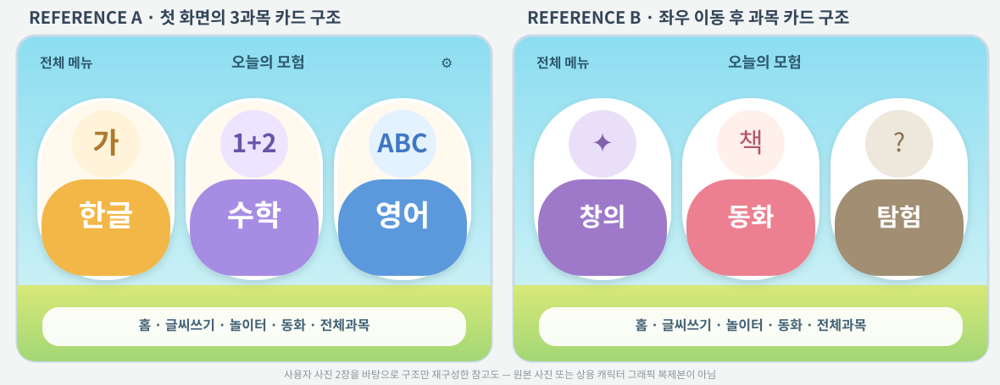

# 쪼이랜드 v13 홈 UX 리뉴얼 — 밀크T아이 관찰 기반 설계 지시서
작성: 2026-11-17 / **구현·브라우저 검증 기록 추가, 실기기 검증 미완료**
우선순위: P1 (기존 v13 홈/학습관 그래픽 리뉴얼의 연속 작업). 신규 독립 앱/프로젝트가 아님.
원천: 사용자 제공 밀크T아이 태블릿 실촬영 2장(2026-11-17). 사진의 실제 화면 특징만 벤치마킹하고, 브랜드/캐릭터/일러스트/아이콘/그래픽 구성 자체를 복제하지 않는다. 쪼이랜드의 원본 쪼이와 이미 제작된 고품질 v13 아트를 재활용한다.

## 시각 참고자료 (2026-11-17)

- 위 SVG는 **사용자 제공 실제 사진 2장의 레이아웃을 분석해 재구성한 다이어그램**이며, 사진 원본이나 원본 캐릭터를 복제한 화면이 아니다. 사진 원본(사용자 채팅 첨부 파일: 1000061039.jpg 및 1000061040.jpg)은 이 저장소에 아직 바이너리로 포함되지 않았다.
- **사진 1 관찰:** 밝은 하늘/잔디 배경, 화면 중앙에 한글·수학·영어의 큼직한 3개 과목 카드, 오른쪽에 다음 카드 단서, 상단 상태/제어 아이콘, 하단 공통 기능 선반.
- **사진 2 관찰:** 좌우 이동 후 비슷한 크기의 다른 과목(아이 누리·아이 동화 등) 카드 3개가 보이고 하단 기능 선반은 동일한 위치를 유지함.
- **배울 원칙:** 어린이가 한눈에 보이는 소수의 큰 카드, 한 화면 안에 들어오는 안정적 배치, 다음 화면 탐색의 발견성, 고정된 하단 바로가기. 쪼이랜드에서는 밀크T아이의 캡슐 형태·캐릭터·색상·아이콘 등의 창작 표현을 그대로 복제하지 않는다.
- **중요:** 참고도의 A/B 세 과목 텍스트는 **원본 사진 설명**일 뿐 운영용 홈 고정 목록이 아니다. **실제 쪼이랜드 홈은 하루마다 10개 과목 중 3개를 순환 노출**해야 한다. 일일 순환 규칙은 아래 '최신 사용자 결정'이 우선한다.

## 0. 의사결정 요약
현 홈은 hero, 학습 시작, 상태/추천, 10개 과목 그리드와 추가 카드가 길게 이어지는 정보 중심 구조라 어린이가 **처음 3초 안에 어디를 눌러야 할지 구별하기 어렵다**. 이를 **"큰 과목 3개 + 옆으로 탐색 + 하단 상시 바로가기"**라는 정보 구조로 바꾼다. 밀크T아이의 세부 이미지, 색상 배치, 캡슐 디자인, 소품, 마스코트, 그래픽 표현을 베끼지 않는다.

**태블릿 가로가 기준 디자인**, 태블릿 세로·휴대폰 세로/가로에서는 적응형 레이아웃. 5세 아동이 글을 못 읽어도 과목을 그림과 색으로 구별할 수 있어야 한다. 홈에서는 1~4단계별 메뉴를 나열하지 않는다; 진입 후 각 놀이 안에서 기존 5문제 흐름을 유지한다.

## 1. 실사진에서 확인한 장점과 개선 가설
- 첫 화면: 큰 한글/수학/영어 카드가 화면 중앙을 차지. **3개 모두 큰 글자 + 서로 다른 과목 그림 + 배경색**으로 인지하기 쉬움.
- 오른쪽 일부 다음 카드와 화살표가 보여 **수평 이동이 가능함을 암시**. 두 번째 사진은 아이 누리/아이 동화 등 후속 영역을 보여줌.
- 하단의 작지만 지속적인 과목/콘텐츠 바로가기와 상단의 소수 기능 아이콘이 위치를 유지.
- 배경은 단순한 하늘·잔디 2개 층으로 컨텐츠 대비가 강함.
- 화면 아래로 수많은 카드를 찾는 방식보다 과목 선택 작업이 빠르다는 **사용성 가설**임. 실측 클릭 데이터가 있는 것은 아님.

## 2026-11-17 최신 사용자 결정: 홈 '오늘의 3과목' 일일 로테이션 (이전 '고정 한글·수학·영어' 지침을 대체)
**이 섹션이 이 파일 및 V13-BACKLOG.md의 과거 '한글/수학/영어 고정' 문구보다 우선한다.** 아래 본문의 고정형 설명은 이전 버전 기록이며 구현 기준이 아니다.

- **사용자 요청:** 이미 만들어둔 10개 학습 주제 중 **매일 3개씩** 홈 중앙에 큰 그림 카드로 보여준다. 한글·수학·영어를 영구 고정하지 않는다. 과목 선택 순서도 날짜가 바뀌면 바뀐다.
- **고정되는 것은 3개 카드의 레이아웃**이다. 매일의 3과목이 바뀌어도 캐러셀/하단 바로가기 및 원본 쪼이 디자인은 안정적으로 유지한다.
- **로테이션 제안(구현 시 확정 검증):** 기존 10개 과목 ID를 실제 저장소에서 확인해 안정된 목록으로 구성한다. 초기 순서를 한글·수학·영어·과학·역사·코딩·투자·생활·창의·읽기 등 실제 명칭에 맞춰 10개로 확정한 뒤, 날짜의 서울 시간(Asia/Seoul) 일수 인덱스 D를 사용하여 오늘 카드 = [subject[(3D)%10], subject[(3D+1)%10], subject[(3D+2)%10]]. 같은 날짜에는 앱을 다시 열거나 새로고침해도 변하지 않고 자정 이후에만 바뀐다. **서로 다른 과목 3개**가 보이고 10과목 모두 최대 4일 내 등장하며, 10일 동안 각 과목이 정확히 3회 표시된다. localStorage에 오늘 날짜와 결과를 선택적으로 기록하되 알고리즘과 충돌 없이 오프라인에서도 결정적이다. 보이는 3카드만 날마다 바꾸고 원래 전체 10과목 목록/학습 데이터/진도는 변경하지 않는다.
- **아이의 선택권:** 첫 화면에 보여주는 3개는 **오늘의 추천**이며 강제 학습 순서가 아니다. 바로 아래 **'전체 과목 보기'**에서 항상 10개 과목에 접근할 수 있도록 한다. 가로 캐러셀을 쓴다면 오늘 3개가 우선 보이고 나머지를 계속 탐색할 수 있게 하되, 어느 화면에서도 10개 과목의 링크가 사라지면 안 된다. '글씨쓰기'는 날짜와 관계없이 홈에서 한 번에 진입 가능해야 한다.
- **이어서 하기:** 최근 학습 이력은 오늘의 3개를 덮어쓰거나 섞지 않는다. 독립적인 '이어서 하기' 버튼에 놀이명/직전 진도(예: 3/5)를 표시한다. 최근 방문 과목이 오늘 카드에 없더라도 재개는 항상 가능해야 한다.
- **첫날 기본값:** 테스트 환경의 날짜 기준으로 실제 매칭을 계산한다. 한글·수학·영어가 오늘의 기본 3개일 수 있으나 그 다음 날부터 반드시 순환한다. 임의로 random()을 매 렌더링에 호출하여 새로고침 때 카드가 바뀌는 구현은 금지한다.
- **검증:** 같은 날 서로 다른 접속/재시작 시 동일 3카드, KST 자정 경계에서 변경, 10일간 10개 과목별 정확히 3회 노출, 하루 3개 카드 중복 없음, 전체 과목 링크·다른 과목 이어하기 접근성, 오프라인/태블릿 가로/작은 폰 레이아웃 테스트.
- **기존 '학습관 내부 구조는 미결정' 방침 유지.** 이 변경은 홈 과목 편성만 바꾸며 현재 진행 중인 v13 작업을 다시 시작시키지 않는다.

## 2026-11-17 사용자 확정 결정 — 이 항목이 앞선 유동 옵션보다 우선
1. **태블릿/설치형 PWA는 가로 방향 우선·가로 고정 시도**. 밀크T아이처럼 홈을 태블릿 가로 전체 화면에 맞춰 설계한다. `manifest.webmanifest`의 `orientation: "landscape"` 등을 검토하고 설치형 PWA에서 실측 테스트한다. 브라우저와 OS마다 강제 고정 지원이 다르므로 일반 URL 접속에서 가로 전환이 보장된다고 주장하지 않는다. 미지원일 때는 세로 화면에서 '태블릿을 가로로 돌려 주세요' 안내와 기능 접근 가능성을 제공한다. **설치형 가로 고정이 실제 성공하는지 대상 태블릿에서 확인해야 완료 처리**한다.
2. **[이전 결정 / 2026-11-17 교체됨]** 홈 3과목 한글·수학·영어 영구 고정은 최신 '오늘의 3과목' 일일 로테이션 요구로 대체되었다. 위 최신 섹션을 구현 기준으로 한다.
3. **마지막 학습 과목을 1번 과목으로 자동 재배치하지 않는다.** 대신 첫 화면의 별도 작고 알아보기 쉬운 **'이어서 하기'** 단축 버튼/패널에 직전 학습 과목, 놀이명, 진행 위치를 표시한다. 기록이 없으면 해당 영역을 숨기거나 '오늘의 한글 쓰기'로 대체한다. 마지막 진도/놀이 저장 방식은 기존 localStorage 또는 현재 진도 관리 API 재사용; 데이터 구조 임의 변경 금지. 완료된 단계라면 다음 미완료 단계로 이동할지 안전하게 계산하고 기록 없는 경우 일반 과목 페이지로 이동한다. 아이가 탭 1번에 정확한 진도로 재개 가능하도록 검증한다. **학습 기록은 기기 내 저장**을 기본으로, 개인정보 전송·새 계정 생성 요구하지 않음.
4. **학습관 내부 구조·놀이 상세 화면의 추가 개편 방식은 아직 미결정**. 사용자 추가 의견 전에는 내부 UI를 새로운 단계/탭 구조로 재설계하지 않는다. 이미 진행 중인 v13 공통 그래픽 리뉴얼과 버그 수정은 중단하지 않고 유지한다. 이번 확정 범위는 홈 IA, 가로형 레이아웃, **하루 3과목 순환**, 이어하기 배치 기준으로 한정한다.
5. 검증 추가: 태블릿 설치형(PWA) 가로 고정·복귀 후 방향·앱 재시작, 일반 모바일 브라우저의 미지원 폴백, **오늘의 3과목 일일 로테이션·당일 동일성·10일 균등 노출**, 최근 학습 과목과 오늘의 3과목 독립성, 이어하기 직전 진도 이동, 세로 안내가 학습/내비게이션을 막지 않는지 실제 화면 검사.

## 2. 쪼이랜드의 독자 홈 IA
### A. 상단 (가능하면 한 줄, 태블릿)
왼쪽: 원본 쪼이 얼굴 + **쪼이랜드** / 중앙: 짧은 한 줄 안내('오늘은 어떤 모험?') / 오른쪽: 보호자 설정, 소리 ON/OFF, 전체 메뉴. 날짜는 필요할 때만 작은 보조 정보. 어린이에게 불필요한 아이콘·숫자·계정·알림은 삭제 또는 보호자 메뉴로 이동. 원본 호랑이 얼굴 절대 교체 금지.
### B. 가운데 커다란 과목 선택
- 태블릿 가로 1024px 이상: 카드 3개가 **한눈에 보이는 중앙 카루셀** (이전/다음 버튼 + 스와이프 + 키보드 접근); 옆 카드 일부 노출로 탐색성 강조. 카드 크기/그림은 모두 같은 기준, 선택한 카드만 약간 강조. 과목 카드는 날짜별로 달라지며 최초 3개만 보여 주는 '오늘의 3과목'이 주인공이다.
- 카드 목록: 한글 / 수학 / 영어 / 과학 / 역사 / 코딩 / 투자 / 생활 / 창의 / 읽기 (실제 저장소 ID 확인 및 **오늘의 3과목 순환** 적용). **실제 기존 10개 학습관 ID와 연결**; 명칭은 코드의 기존 라벨을 검토하여 정확히 맞춘다. 캐릭터와 과목 이미지는 각기 달라야 하며 이미지 의미가 실제 학습과 일치해야 한다.
- 카드 그림 (독자 디자인): 병 속 장난감 같은 기존 레퍼런스 표현을 복제하지 말고, **'쪼이의 모험 세계 입구'** 컨셉으로 입체적인 이야기 장면과 고유 배경을 묶은 큰 카드 디자인. 서로 다른 과목임을 1초에 인지할 수 있도록 도형·색상·소품 차별화.
- 아이가 글을 못 읽어도 카드 전체를 탭해 이동. 매일의 첫 번째 추천 과목을 시각적으로 강조하되, 최근 학습 기록은 별도 '이어서 하기' 버튼에만 표시한다. 자동 캐러셀 이동 금지(아이의 터치 방해).
- 카드를 눌렀을 때 기존 **journey.html?subject=...** 등 실제 링크와 현재 진행 데이터/음성을 유지. 5문제 완료·다음 단계 동작은 그대로.
### C. 주요 빠른 시작
**글씨쓰기**는 과목 카루셀 안에 숨기지 말고 홈 상단 또는 중앙 하단에 크고 명확한 **'✍ 글씨 쓰기'** 독립 바로가기로 제공. 한글 기초, 영어 대소문자, 숫자 쓰기는 기존 경로 유지. 첫 방문에 바로 시작 가능한 학습이 최우선. 개인화를 위한 '이어하기'가 있으면 보조 버튼으로 배치.
### D. 하단 고정 탐색 선반 (태블릿 가로)
홈 / 글씨쓰기 / 놀이터 / 동화 / 그림낱말 / 색칠공부 / 내 트로피 등 **6~7개 이하** 중요 기능만 표시. 기능당 작지만 **고유한 원본 아이콘과 큰 텍스트**. 기능 중복(두 홈 버튼, '기존 8개 학습관' 우회 등) 제거. 기존 10개 학습관 접근은 카루셀로 해결. 원본 쪼이와 작품 스타일 유지.
- '색칠공부'는 기존 JOY-001 구현을 그대로 링크(중복 재개발 금지).
- 하단 선반은 viewport safe-area를 고려하고 본문/팝업과 겹치지 않게 여백 확보. 게임 내 홈/뒤로가기는 기존 공통 네비게이션과 연동.
### E. 태블릿·스마트폰 대응 (확정: 설치형 태블릿 가로 우선; 미지원 세로 폴백)
- 태블릿 가로 (최우선, 1024/1280/1600×800 등): 상단 10~15% / 과목 55~65% / 하단 15~20% 정도를 **참고 비율**로 구성. 브라우저/기기 하단 내비게이션을 제외한 실제 컨텐츠 영역에서 잘리지 않음.
- 태블릿 세로 800×1280: 중앙 2개 카드 + 다음 카드 일부 또는 한 줄 가로 탐색(실측 비교 선택).
- 폰 세로 360×800, 390×844: 카드 **1개 크게 + 다음 카드 일부** 또는 2개 축소안 A/B 테스트. 지나치게 작은 3카드 강제 금지. 하단 4~5개 핵심 버튼만 노출하고 나머지는 '전체 메뉴'. 고정 요소가 글자/버튼을 덮지 않음.
- 폰 가로 800×360: 큰 장면보다 조작 요소 우선, 높이 제한에 맞춰 배치.
- 눌림 영역은 가급적 44px 이상, 글자 대비 WCAG AA 수준, reduced-motion, screen-reader labels, drag 외 좌우 버튼/키보드 탐색 지원.
### F. 표현 가이드
- 팔레트: 밝은 하늘·산뜻한 초록·따뜻한 색을 '쪼이랜드'답게 재해석. 단순하게 복제하지 않고 고유한 색조 체계. 배경은 저채도/단순화하여 큰 카드가 주인공이 되게 한다.
- 신규 정체성은 **원본 쪼이**. 상용 캐릭터/외부 브랜드의 개별 일러스트나 동일한 과목 카드를 모사하지 않는다.
- 모든 그림은 고품질 원본 아트. v13 실존 WebP 우선 활용하여 **새 이미지 제작 전에 기존 자산 검색/화질 확인**. 저해상도 이미지·왜곡·반복 이모지·의미가 다른 이미지 금지.
- 움직임: 카드 전환 250~350ms의 차분한 모션, 감속형 스냅, 호랑이 미세 표정/반응 정도. 화려한 깜박임·상시 흔들림 금지. 프레임 드롭 방지.

## 3. 작업 순서 — 지금 하던 v13 리뉴얼에서 이어서
1. 현재 작업 브랜치 + origin/main, v13 최종 인덱스, 실제 홈 네비게이션 및 latest status를 먼저 확인. 이전 완료 코드 다시 만들지 않는다.
2. 기존 홈을 태블릿/폰에서 현재 스크린샷으로 캡처하고 정보구조·경로 분석. 이 문서의 내용을 독립 신규 프로젝트로 분리하지 않는다.
3. 사용자 실제 태블릿 사진을 **동작/정보 구조 참고자료**로만 분석한 자체 와이어프레임 및 두 레이아웃 후보를 만든 후 테스트 기준으로 한 가지를 선택. 이미지 파일을 repo에 업로드하려면 사용자 이미지 업로드·권한/기술 경로를 확인한다. 사진 없이도 이 문서만으로 작업 가능하다.
4. 기존 v13 고품질 이미지와 원본 쪼이로 모바일·태블릿 반응형 홈 구현. 컴포넌트/JS는 필요한 만큼만 분리. 기존 SPA/페이지 링크, 진도, 오디오, 로컬 데이터, 서비스워커 캐시 준수.
5. **시각적 QA**: 360×800, 390×844, 800×1280, 1280×800, 1600×900. 실제 이미지 로드·가로 스크롤·레이아웃 넘침·하단 겹침 확인. 카드 10개 전체 및 7개 하단 메뉴 탭, 좌우 스와이프·좌우 버튼, 브라우저 뒤로/홈, direct URL, 온/오프라인 복귀 검증.
6. A/B 전후 비교 사진 및 '처음 진입 후 한글/글씨쓰기 1회 탭 도달' 확인. 5세 미취학 아동 이해 가능 여부는 사용자 기기에서 별도 검수해야 함. 기능 QA와 브라우저 QA 전부 수행.
7. 개발 브랜치 중간 커밋·푸시, V13-STATUS.md 갱신 및 스크린샷 기록. main 배포는 현재 운영 정책/PR 검토와 자동검사에 맞춰 진행; 충돌/권한 제한은 정확히 보고.

## 4. 합격 기준
- 태블릿 가로 첫 화면에 **오늘의 추천 과목 3개(날마다 변경)+하단 상시 기능**이 화면 안에 들어옴. (브라우저 UI 제외, 실측 캡처)
- **오늘의 추천 3과목 각 1회 탭 진입**, 나머지 7과목도 전체 과목 보기/좌우 탐색으로 접근 가능. 한글·수학·영어 역시 추천에서 제외된 날에도 접근 가능. **글씨쓰기는 첫 화면 1회 탭**.
- 10과목, 글씨쓰기, 놀이터, 동화, 그림낱말, 색칠공부 등 기존 주요 기능 URL과 상태/진도 유지.
- 앱 내부 어디서든 뒤로/홈은 일관되게 작동. 숨겨진 2번째 홈/오래된 별도 8개 학습관 진입 강제 없음.
- 그림이 과목별로 구별되고 기본 이모지 대체/원본 쪼이 교체/저해상도 뭉개짐 없음.
- 모바일·태블릿 스크린샷의 텍스트 잘림·카드/하단 겹침·의도치 않은 가로 스크롤 0. 기존 5문제·획별 따라쓰기·5분 트로피 등 게임 로직 유지.
- 부드러운 조작(실측)과 접근성. 자동검사 통과뿐 아니라 **실제 스크린샷 직접 시각 검사** 필수.
- 반드시 V13-STATUS.md에 완료/미완료, 검증 경로, 이미지 재사용 여부, 커밋/브랜치를 남긴다.

## 5. 범위 제한 및 우선순위
- 이것은 **신규 기능 요청 아님**: v13 전체 그래픽/UX 리뉴얼의 홈 화면 설계 구체화. 기존 JOY-001 색칠공부를 다시 개발하지 않는다.
- 스크린샷의 밀크T아이 상표·캐릭터·색상/캡슐/아이콘 구성을 그대로 복제하지 않는다. 배우는 것은 **인지하기 쉬운 주제 중심 내비게이션, 큰 시각적 클릭 표면, 좌우 탐색의 발견성, 고정된 빠른 메뉴**라는 원칙.
- 아직 디자인 구현/배포 완료로 표시하지 않는다. 기존 진행 중인 다른 v13 작업은 보존하고, 우선순위는 마무리된 작업/QA와 충돌하지 않도록 관리한다.

## 2026-11-17 사용자 제공 과목 진입 영상 분석 — 신규 오프닝 UX
**자료:** 사용자 촬영 밀크T아이 '한글 카드 터치 → 로딩 → 한글 오프닝' 약 11.95초 동영상. **영상에서 실제 관찰한 사항**: (1) 약 0~1.5초 홈 카드 선택; (2) 약 2~7초 푸른 하늘/초록 언덕의 동물 캐릭터 다섯 명과 차오르는 진행 막대; (3) 약 7.5~9초 구름 사이 등장하는 펼쳐진 책 및 입체 구름 장면 전환; (4) 약 9~11.95초 짙은 파란 배경에서 우산·달·숫자·별들과 함께 커다란 '한글' 타이틀이 나타남. 영상은 타이틀 화면에서 끝나므로 학습 본화면 진입 시각은 관찰 불가. 음성 내용은 이번 분석에서 검증하지 않았다.

### 디자인 적용 목적
밀크T아이의 캐릭터, 화면, 글자 배치와 소품을 그대로 복제하지 않고, **과목 선택 → 캐릭터 반응 → 짧은 세계관 전환 → 과목 제목 등장 → 실제 학습 화면**의 감정적 흐름과 UX 원칙을 활용한다. 쪼이랜드 원본 호랑이 쪼이가 오프닝의 주연.

### 권장 연출
- 한글: 원본 쪼이가 커다란 동화책을 펼치면 자음/모음 조각들이 등장하여 '한글' 타이틀을 형성. 글자 형태 오류 금지.
- 수학: 숫자 블록이 쌓이고 쪼이가 숫자를 세어 '수학' 표시.
- 영어: A·B·C 블록이나 알파벳 연이 날아와 '영어' 표시.
- 다른 7과목은 세계관별로 아트·움직임 차별화하되 **우선 한글 1개를 고품질 시제품으로 제작·검증**. 바로 10개를 저품질로 일괄 생성하지 않는다.
- 3~5초 목표의 짧은 오프닝(추천값, 측정 후 조정). 실제 데이터 준비를 가장하지 않으며 **로딩 바는 실제 준비 상태에만 연결**. 준비 끝나면 건너뛰기 또는 짧은 완결 연출 후 즉시 진입.
- 건너뛰기, '다시 보기', reduced-motion/음소거/저사양 기기 fallback, 화면 회전/뒤로가기/홈 복귀, 반복 방문 시 짧은 버전 선택 제공. 연출 시간 중 강제 대기/화면 블로킹 최소화.
- 태블릿 가로 16:9에 최적화, 모바일 세로 등 미지원 상황은 중앙 크롭/대체 포스터. 픽셀 아트가 아닌 기존 v13의 고품질 이미지와 원본 쪼이 기준으로 프레임 일관성 유지. 그림·움직임은 가능한 원본 에셋과 CSS/Canvas/영상(WebM/MP4) 중 성능과 유지보수 기준으로 선택; 자동 재생 정책 때문에 사운드와 사용자 탭 시작 타이밍을 분리 검토한다.
- 퍼블리시 전 검증: 파일 크기, 첫 프레임 표시, 재생/중단/다음 화면 전환, 실제 준비 상태 및 오프라인, 360×800·1280×800 태블릿, FPS/저사양 기기 지연, 접근성, 동일 자산 중복생성 없음. 사용한 오프닝 방식과 실제 동영상/브라우저 캡처를 V13-STATUS.md에 기록한다.

**범위 관리:** 기존 v13 홈 IA 작업의 세부 과목 진입 연출로 포함하며, 기존 학습관 내부 구조 변경을 임의로 확대하지 않는다. 아직 계획으로만 등록; 실제 동영상 제작·배포 완료 표시 금지.

## 2026-11-17 구현 상태
일일 3과목 홈과 전체 메뉴·글씨쓰기·정확한 문제 이어하기, 일일 동화 3편 및 한글 오프닝을 구현하고 브라우저 검증했다. V13-STATUS.md v14.6 및 docs/v13/home-daily 참조. 기존 사진/참고도는 정보구조만 참고하고 원본 쪼이·기존 아트를 재사용했다. 설치형 태블릿 가로 고정/재시작·실기기 청취·아이 사용성·저사양 성능은 여전히 미검증. 다른 과목 오프닝은 미완료.
